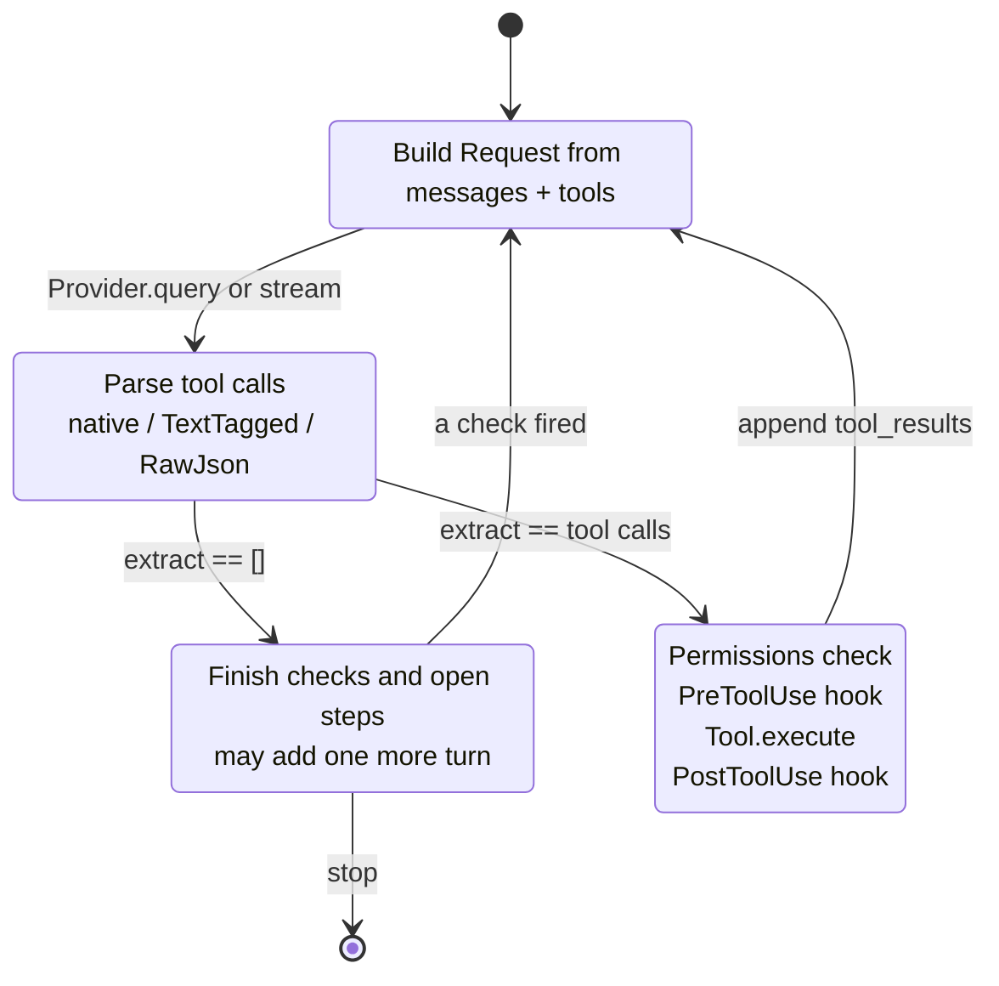

# 04 · The chat and its permission levels

> **What this answers:** how does the one chat decide how to work, what does each permission level let it do, and how would I write a custom mode?
> **Audience:** consumers wiring up a chat; contributors writing a mode.

---

## One chat, one setting

ExAthena used to offer four modes: ReAct, Plan-and-Solve, Reflexion and Orchestrate. Each behaved differently, and none could do what another did mid-chat. Since issue 306 there is one chat, `ExAthena.Modes.ReAct`. The model decides how to work inside it: it writes a to-do list when a task has steps, sends a helper (`spawn_agent`) when a job is big or separate, and checks its work before it says done.

The one thing a person picks is how much the chat may do without asking. That is the run's `:phase` plus a `can_use_tool` callback, built for you by [`ExAthena.Chat.Permission`](../lib/ex_athena/chat/permission.ex):

- **Read only (plan)** (`:read_only`, phase `:plan`): the chat looks around and changes nothing. It is told to call `plan_mode` with `action: "exit"` and its plan once it has one. The person approves the plan with edits asked or allowed, or tells it to keep planning.
- **Ask before edits** (`:ask`, the default): every edit and every command that can change something asks Allow or Deny first.
- **Edit freely** (`:edit`): edits run; commands that can change something still ask.
- **Trusted** (`:trusted`, phase `:trusted`): everything runs.

Reading and searching files, the to-do list, questions, `finish`, skills and helpers never ask. Below Trusted, every command, web fetch, web search and GitHub call asks, Read only included (where a command that fails the read-only test is refused outright), and the language server asks once per run. A helper is held to its parent's level, since it inherits the parent's phase and callback, and it cannot leave Read only on its own.

```elixir
ask = fn question, options -> MyUI.ask(question, options) end   # returns the answer text
{_ref, opts} = Keyword.pop(ExAthena.Chat.Permission.run_opts(:read_only, ask), :level_ref)
ExAthena.run("add rate limiting to the login endpoint", [provider: :ollama] ++ opts)
```

The web UI asks through the question card, the terminal UI through a popup. The removed modes return `{:error, {:removed_mode, mode, hint}}` from `ExAthena.run/2`:

- `:plan_and_solve` → start with phase `:plan`, and approve the plan.
- `:reflexion` → the finish checks below stop a run from claiming done without proof.
- `:orchestrate` → every chat can send helpers, under the same limits.

---

## The chat (ReAct)



Reference implementation in [`lib/ex_athena/modes/react.ex`](../lib/ex_athena/modes/react.ex). Highlights:

- **Streaming-aware**: uses `Provider.stream/3` when `:on_event` is set on the loop, otherwise `query/2` ([`react.ex:78`](../lib/ex_athena/modes/react.ex#L78)).
- **ChatParams hook** fires before each provider call ([`react.ex:56`](../lib/ex_athena/modes/react.ex#L56)) so hooks can rewrite system prompt / temperature / tools per turn.
- **Parallel tool calls**: read-only tools batch via [`Loop.Parallel.run/3`](../lib/ex_athena/loop/parallel.ex); mutating tools (`parallel_safe?: false`) serialize. See [07 · Tools](07-tools.md).
- **Mistake-counter reset**: any successful tool execution in a turn resets `consecutive_mistakes` to 0 ([`react.ex:118`](../lib/ex_athena/modes/react.ex#L118)).
- **No tool calls = `:stop`**: model returned plain text → final turn.
- **Small models get a to-do list and no helpers** ([`ReAct.init/1`](../lib/ex_athena/modes/react.ex), [`ModelSize`](../lib/ex_athena/model_size.ex)). The size comes from the model's name or Ollama's `/api/show`. Below `chat.small_model_below_b` billion parameters the top-level chat drops `spawn_agent` and `read_worker_report` and adds a to-do note to the system prompt once; `chat.helpers` (`:auto | :on | :off`) overrides the helper half. A model of unknown size counts as large.
- **A stop with open steps gets one more turn**: a top-level chat that stops while its own to-do list still has pending items is told to do the next one, once per request. A chat with no list, and a read-only chat, stop as asked.
- **It checks its work before it says done** ([`Loop.FinishChecks`](../lib/ex_athena/loop/finish_checks.ex)). When a top-level chat stops after changing files, four checks read what its own tool calls and its helpers' reports did: a command ran, a test run passed, a test executed the changed files, and the work was compared with the person's latest message. Each missing check adds one note and one more turn, once per request, a resume included. Helpers are not checked, and `config :ex_athena, :chat, finish_checks: false` turns the checks off.
- **Helpers in every chat**: a top-level chat briefs each helper with an objective, the expected output, tool guidance and boundaries (missing parts get defaults), and appends the worker contract to its prompt. Helpers run one at a time, nest at most two deep, count against `max_agents_per_run`, and send back a summarised report. See [13 · Agents and subagents](13-agents-and-subagents.md).

---

## Writing a custom mode

Minimum implementation:

```elixir
defmodule MyApp.CountingMode do
  @behaviour ExAthena.Loop.Mode

  alias ExAthena.Loop.State

  @impl true
  def init(%State{} = state), do: {:ok, %{state | mode_state: %{turns: 0}}}

  @impl true
  def iterate(%State{mode_state: %{turns: n}} = state) when n >= 5 do
    {:halt, ExAthena.Loop.set_finish_reason(state, :stop)}
  end

  def iterate(%State{} = state) do
    # … run inference, parse tool calls, etc. (delegate to ReAct primitives)
    new_state = put_in(state.mode_state[:turns], state.mode_state.turns + 1)
    {:continue, new_state}
  end
end
```

### What you get for free from the kernel

- Iteration / mistake / budget / no-progress caps
- Compaction (proactive + reactive)
- Session* / UserPromptSubmit / Stop / SessionEnd hooks
- Telemetry spans
- Result assembly

### What you must do yourself

- Call `Provider.query/2` or `Provider.stream/3` (via the state's `provider_mod` / `provider_opts`)
- Parse tool calls via `ExAthena.ToolCalls.extract/2`
- Gate tool calls via `ExAthena.Permissions.check/3`
- Fire `PreToolUse` / `PostToolUse` via `ExAthena.Hooks.run_*`
- Execute tools (use `ExAthena.Loop.Parallel.run/3` to handle parallel-safe batching)
- Append assistant + tool_result messages to `state.messages`
- Set `finish_reason: :stop` on halt: `ExAthena.Loop.set_finish_reason(state, :stop)` (private but stable — see [`loop.ex:356`](../lib/ex_athena/loop.ex#L356)). For non-`:stop` halts your mode should also set `finish_reason` to a member of `Loop.Terminations.all/0`.

The 200-line `ReAct` module is the reference — copy and modify.

---

## Contributor notes

- **`mode_state` is yours**: anything mode-specific (phase, counters, intermediate plans) goes there. The kernel doesn't touch it.
- **No tool-call termination**: convention is that `Modes.ReAct` sets `:stop` when `tool_calls == []`. Custom modes are free to halt on different signals (e.g. a plan was produced and you treat that as terminal).
- **Provider errors → `{:error, …}`**: let the kernel wrap them as `:error_during_execution`. The one exception is "prompt too long" — return `{:error, :error_prompt_too_long}` so the kernel can attempt reactive compaction.
- **Productivity signal is advisory**: if your mode's notion of "progress" differs (e.g. a mode that counts a review turn as progress even with the same tool fingerprint), implement `productivity_signal/2` and the kernel will defer to you.
- **Hot-path discipline**: `iterate/1` runs in the caller's process. Heavy work (e.g. running a subagent) is fine but must complete before the next iteration starts. Async fan-out belongs in tools, not in the mode itself.
